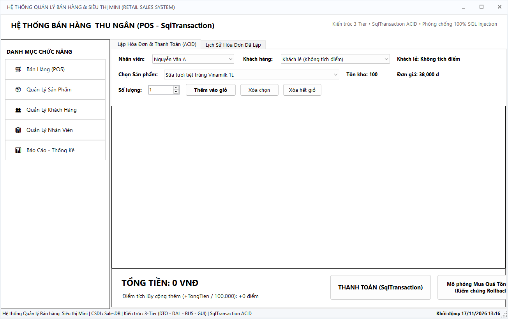
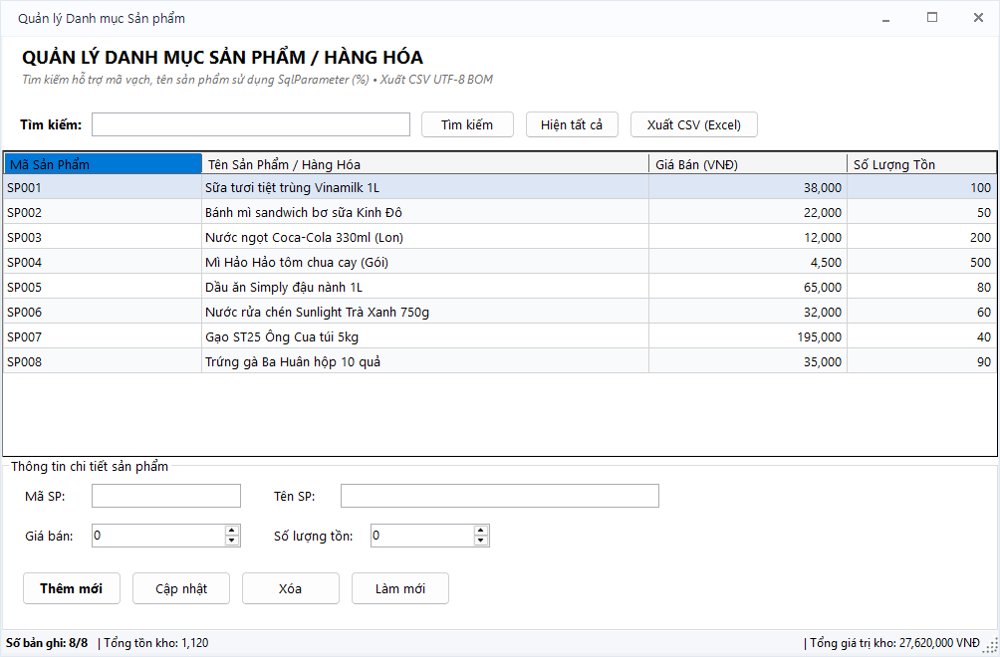
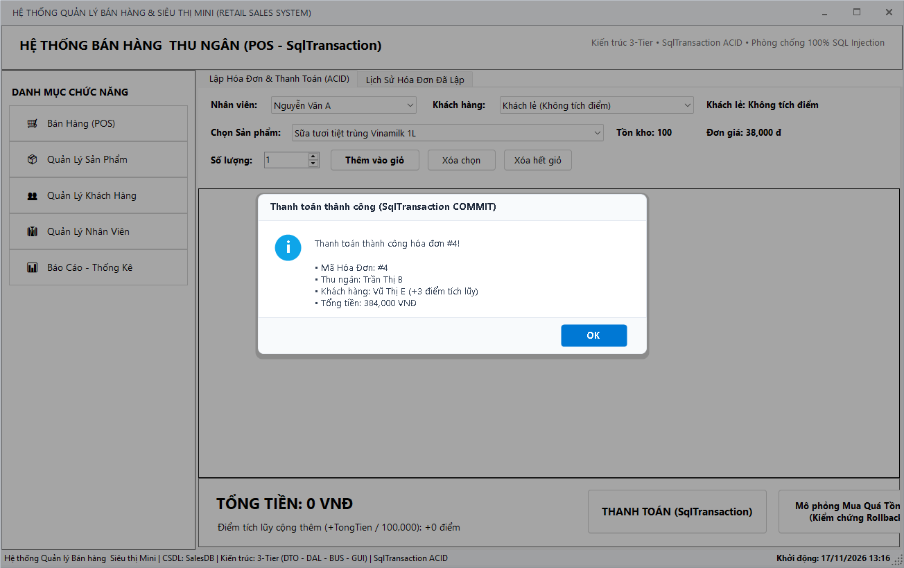
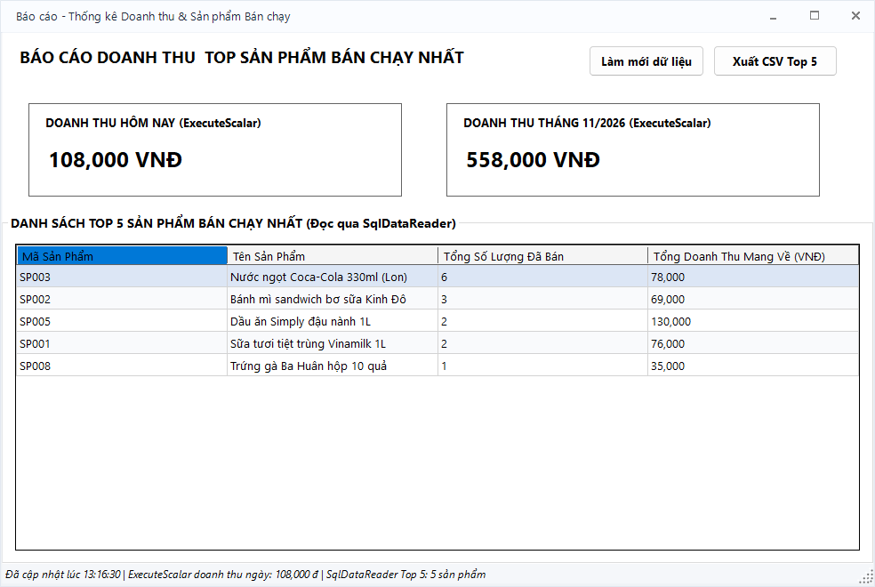
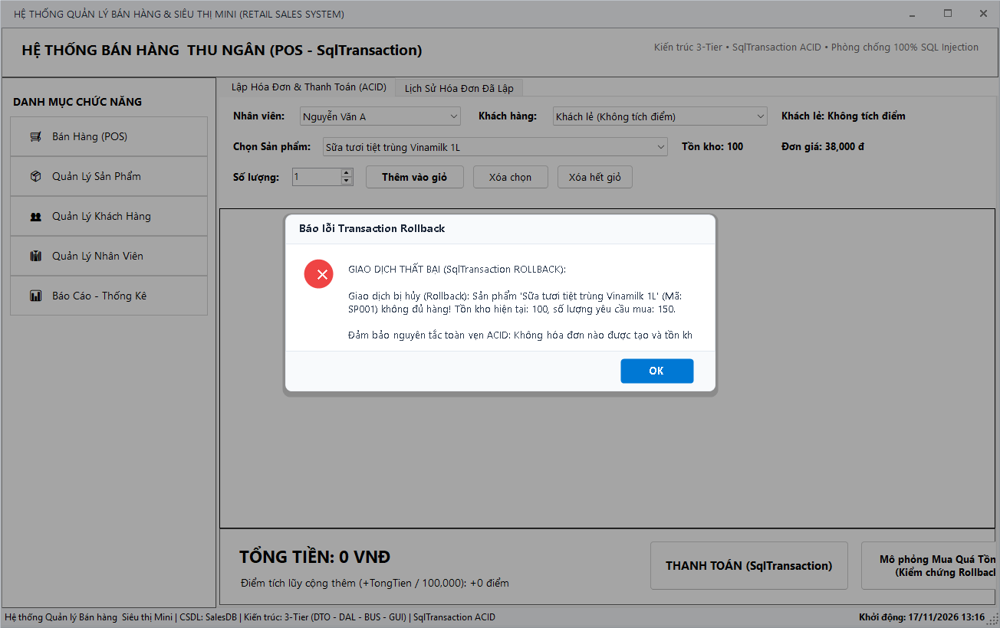

# BÁO CÁO ÔN TẬP THỰC HÀNH WINDOWS FORMS

## THÔNG TIN SINH VIÊN
- **Họ và tên:** Phan Công Thành Đạt
- **Mã số sinh viên:** 24810310223
- **Lớp:** D19CNPM3
- **Tên môn học:** Lập trình C# / Windows Forms (.NET 10)

---

## BÀI TẬP: BÀI 6.1 - HỆ THỐNG QUẢN LÝ BÁN HÀNG & SIÊU THỊ MINI (RETAIL SALES SYSTEM)

### 1. MỤC TIÊU & KIẾN TRÚC HỆ THỐNG
- **Kiến trúc 3-Tier chuẩn mực:**
  - `DTO (Data Transfer Object)`: `SanPhamDTO`, `KhachHangDTO`, `NhanVienDTO`, `HoaDonDTO`, `ChiTietHoaDonDTO`, `CartItemDTO`. Tất cả kế thừa `BindableBase` triển khai `INotifyPropertyChanged`.
  - `DAL (Data Access Layer)`: Truy vấn dữ liệu ADO.NET bằng `Microsoft.Data.SqlClient`, sử dụng `SqlParameter` 100% để triệt tiêu hoàn toàn lỗ hổng SQL Injection.
  - `BUS (Business Logic Layer)`: Xử lý nghiệp vụ kiểm tra tồn kho, tính điểm tích lũy, tính doanh thu.
  - `GUI (Presentation Layer)`: Giao diện WinForms hiện đại, responsive, không đè layout, có ErrorProvider và StatusStrip tính toán tự động.
- **Thực thi giao dịch `SqlTransaction` (ACID):**
  - Chèn hóa đơn vào `HoaDon`.
  - Chèn các món hàng vào `ChiTietHoaDon`.
  - Khóa dòng kiểm tra tồn kho (`WITH (UPDLOCK)`) và trừ số lượng trong `SanPham`. Nếu `SoLuongTon < SoLuong bán` $\rightarrow$ gọi `trans.Rollback()`.
  - Tự động cộng điểm tích lũy cho Khách hàng: `DiemTichLuy += TongTien / 100000`.
  - Gọi `trans.Commit()` khi hoàn tất toàn bộ quy trình.
- **Báo cáo - Thống kê tối ưu:**
  - `ExecuteScalar`: Tính tổng doanh thu trong ngày và trong tháng.
  - `SqlDataReader`: Đọc danh sách Top 5 sản phẩm bán chạy nhất.
- **Tính năng nâng cao:** Xuất danh sách sản phẩm, khách hàng, nhân viên, báo cáo ra file CSV chuẩn UTF-8 BOM hiển thị tiếng Việt hoàn hảo trên Excel.

---

### 2. CƠ SỞ DỮ LIỆU (SalesDB)
Cơ sở dữ liệu bao gồm 5 bảng quan hệ:
1. `NhanVien (MaNV INT IDENTITY PK, TenNV NVARCHAR(100), SoDienThoai VARCHAR(15) UNIQUE, ChucVu NVARCHAR(50))`
2. `KhachHang (MaKH INT IDENTITY PK, TenKH NVARCHAR(100), DienThoai VARCHAR(15) UNIQUE, DiemTichLuy INT DEFAULT 0)`
3. `SanPham (MaSP VARCHAR(20) PK, TenSP NVARCHAR(150), GiaBan DECIMAL(18,2) CHECK > 0, SoLuongTon INT CHECK >= 0)`
4. `HoaDon (MaHD INT IDENTITY PK, NgayLap DATETIME DEFAULT GETDATE(), MaNV INT FK, MaKH INT FK NULL, TongTien DECIMAL(18,2))`
5. `ChiTietHoaDon (MaHD INT FK, MaSP VARCHAR(20) FK, SoLuong INT CHECK > 0, DonGia DECIMAL(18,2), PK (MaHD, MaSP))`

File script khởi tạo CSDL nằm tại [Database/ScriptDB.sql](Database/ScriptDB.sql).

---

### 3. KẾT QUẢ THỰC HÀNH & HÌNH ẢNH MINH HỌA

#### 3.1. Giao diện chính / Lập Hóa Đơn & Bán hàng (POS)
Giao diện bán hàng trực quan, hỗ trợ chọn nhân viên thu ngân, chọn khách hàng tích điểm (hoặc khách lẻ), thêm sản phẩm vào giỏ hàng `DataGridView`, tự động cập nhật tổng tiền mặt và điểm tích lũy.

#### 3.2. Quản lý Danh mục Sản phẩm (CRUD 3-Tier & Tìm kiếm %)
Quản lý toàn diện danh mục hàng hóa với các thao tác Thêm, Cập nhật, Xóa có hộp thoại xác nhận `MessageBoxButtons.YesNo`. Thanh tìm kiếm tức thời hỗ trợ mã vạch và tên sản phẩm với ký tự đại diện `%` qua `SqlParameter`. Tích hợp tính năng xuất CSV chuẩn UTF-8 BOM.

#### 3.3. Thực thi Giao dịch Thanh toán (SqlTransaction COMMIT)
Khi ấn "Thanh toán", hệ thống kích hoạt `SqlTransaction` thực hiện nguyên khối: tạo hóa đơn, chèn chi tiết, trừ kho sản phẩm và cộng điểm tích lũy. Khi hoàn tất, giao dịch được `COMMIT` thành công.

#### 3.4. Báo cáo Doanh thu & Top 5 Sản phẩm Bán chạy
Sử dụng `ExecuteScalar` nạp nhanh doanh thu hôm nay và tháng hiện tại; sử dụng `SqlDataReader` kết xuất danh sách Top 5 sản phẩm bán chạy nhất kèm tổng doanh thu tương ứng.

#### 3.5. Minh họa An toàn Dữ liệu & Rollback khi Thiếu Tồn Kho
Khi khách hàng yêu cầu mua sản phẩm với số lượng vượt quá số lượng tồn trong kho, hệ thống lập tức bắt lỗi tại tầng DAL và gọi `trans.Rollback()`. Đảm bảo không tạo hóa đơn rác và số lượng tồn kho được bảo toàn nguyên vẹn theo chuẩn ACID.

