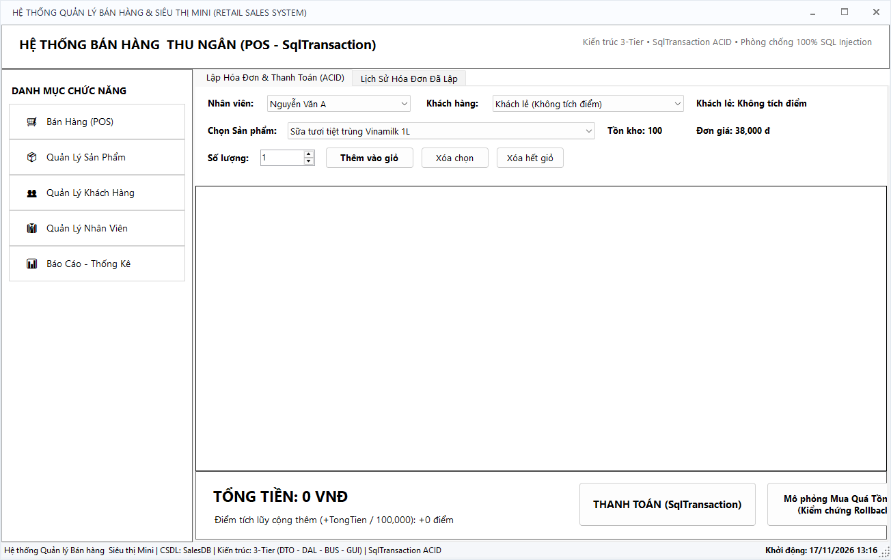
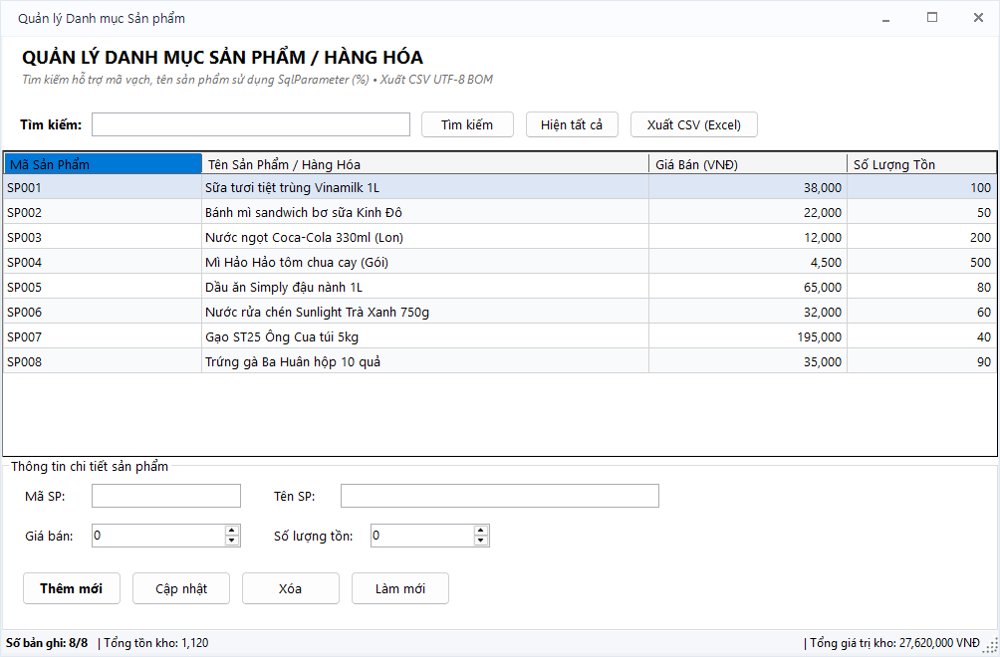
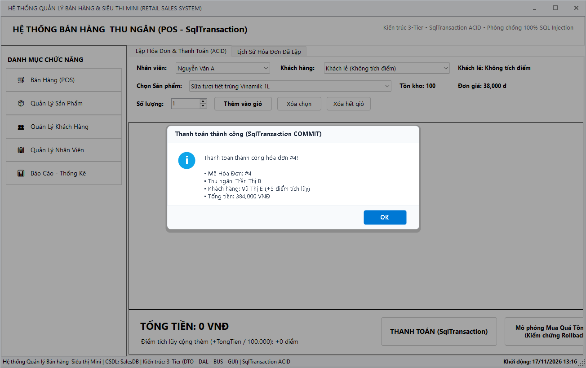
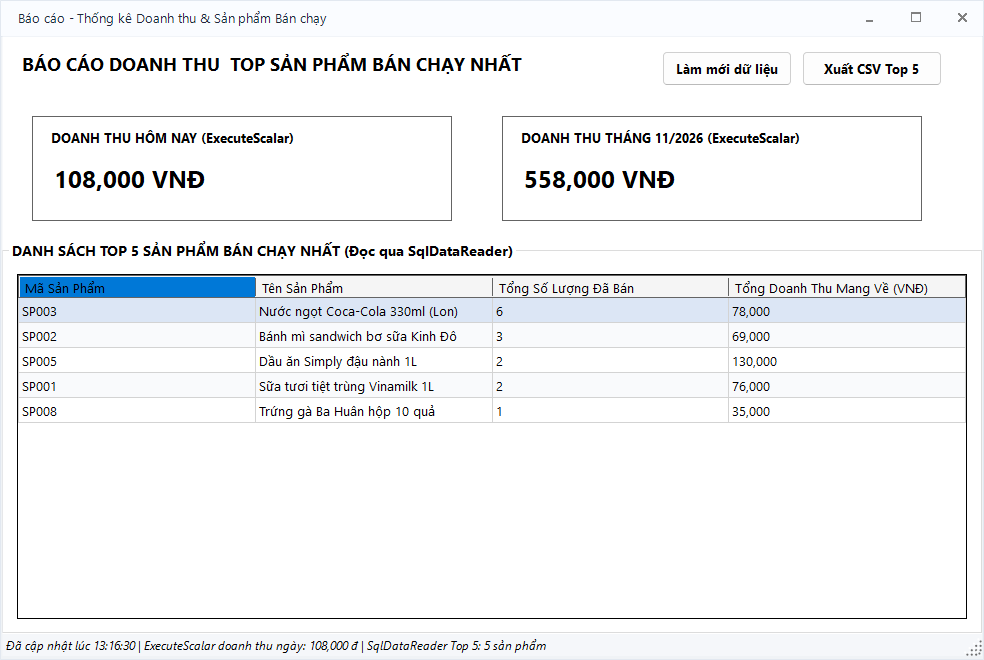
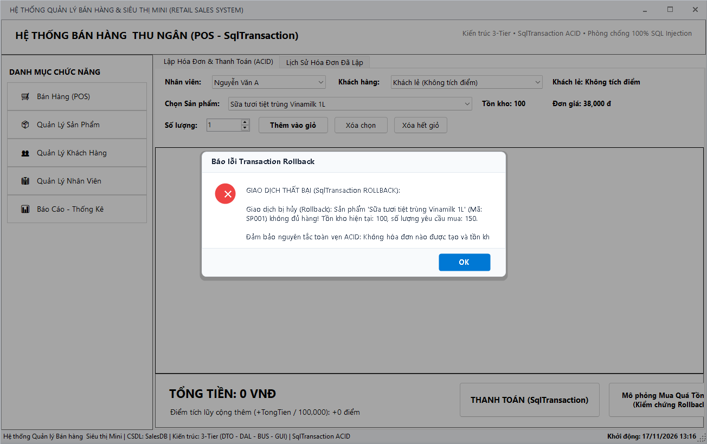
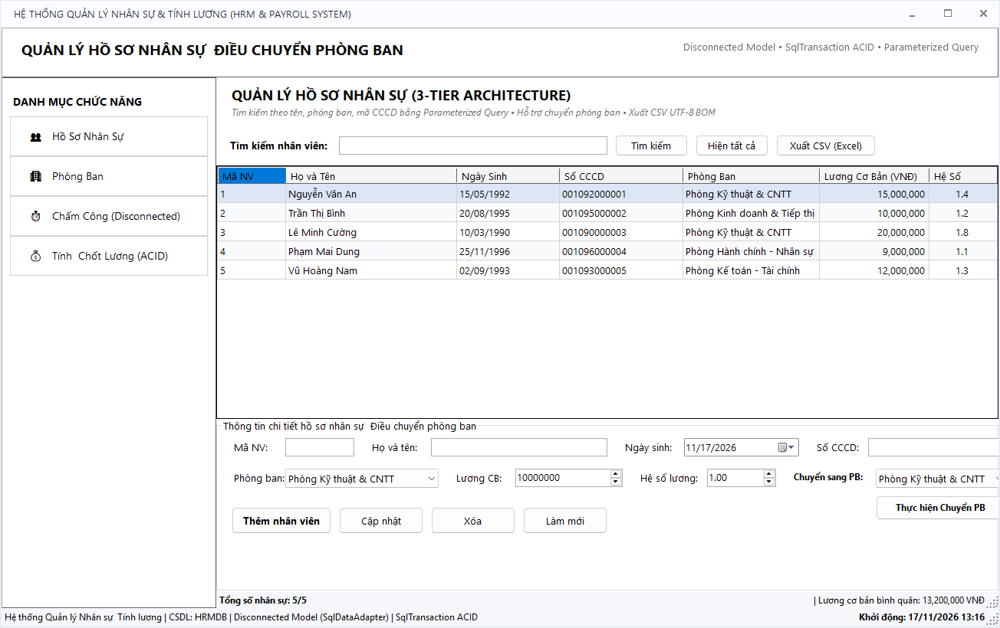
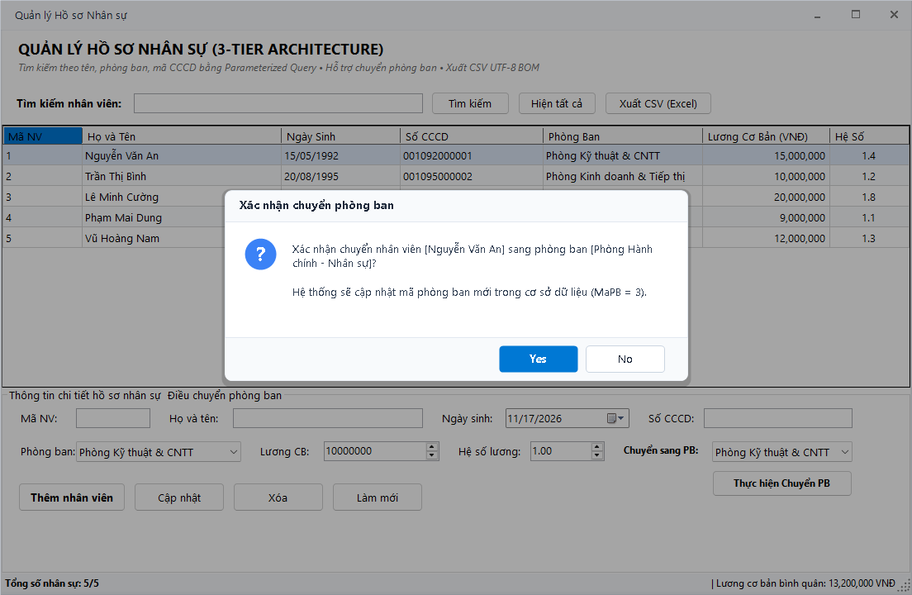
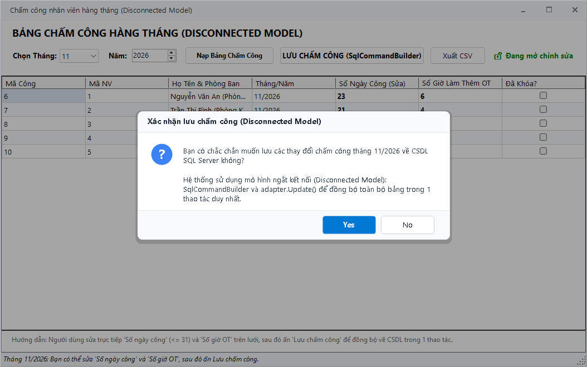
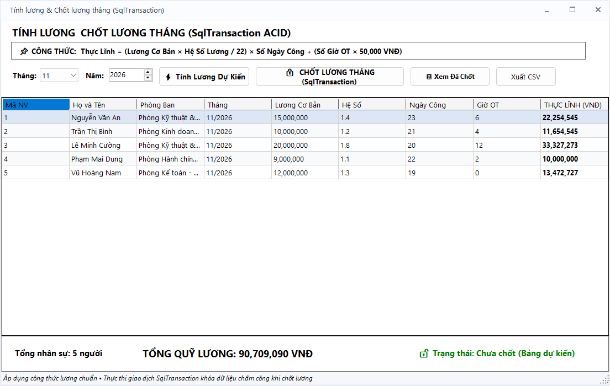
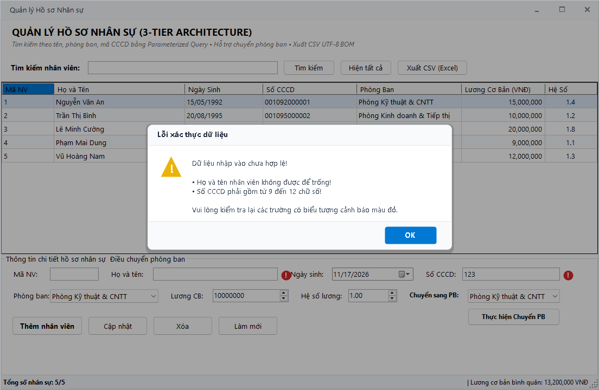

# BÁO CÁO ÔN TẬP THỰC HÀNH WINDOWS FORMS

## MỤC 1: THÔNG TIN SINH VIÊN
- **Họ và tên sinh viên:** Phan Công Thành Đạt
- **Mã số sinh viên:** 24810310223
- **Lớp / Khóa:** D19CNPM3
- **Tên môn học:** Lập trình C# / Windows Forms (.NET 10)
- **Môi trường:** Visual Studio 2022 / SSMS 22 / SQL Server 2025 (`.\MSSQLSERVER01`)

---

## MỤC 2: TỔNG QUAN HỆ THỐNG & DANH SÁCH BÀI TẬP

| Mã Bài | Tên Bài Tập | Công Nghệ Trọng Tâm | Đường Dẫn Solution / Báo Cáo |
| :--- | :--- | :--- | :--- |
| **Bài 6.1** | **Hệ thống Quản lý Bán hàng & Siêu thị Mini (Retail Sales System)** | Kiến trúc 3-Tier, `SqlTransaction` ACID trừ tồn kho, `SqlParameter` chống SQL Injection, `ExecuteScalar`, `SqlDataReader`, CSV UTF-8 BOM | [Báo cáo chi tiết Bài 6.1](Bai_6_1_RetailSalesSystem/README.md) • [Solution](Bai_6_1_RetailSalesSystem/RetailSalesSystem.sln) |
| **Bài 6.2** | **Hệ thống Quản lý Nhân sự & Tính lương (HRM & Payroll System)** | 3-Tier CRUD, Disconnected Model (`SqlDataAdapter`, `DataSet`, `DataTable`, `SqlCommandBuilder`), `SqlTransaction` chốt lương & khóa chấm công, CSV UTF-8 BOM | [Báo cáo chi tiết Bài 6.2](Bai_6_2_HRMPayrollSystem/README.md) • [Solution](Bai_6_2_HRMPayrollSystem/HRMPayrollSystem.sln) |

---

## MỤC 3: HÌNH ẢNH KẾT QUẢ CÁC MÀN HÌNH CHỨC NĂNG

### 1. BÀI TẬP 6.1: HỆ THỐNG QUẢN LÝ BÁN HÀNG & SIÊU THỊ MINI (RETAIL SALES SYSTEM)

1. **Màn hình Chính / Tổng quan hệ thống (Bán hàng POS):**
   

2. **Màn hình Quản lý Danh mục (CRUD Sản phẩm - Thêm/Sửa/Xóa/Tìm kiếm %):**
   

3. **Màn hình Thực thi Nghiệp vụ chính (Thanh toán SqlTransaction COMMIT):**
   

4. **Màn hình Báo cáo - Thống kê (ExecuteScalar & SqlDataReader Top 5):**
   

5. **Minh họa An toàn Dữ liệu (Báo lỗi Transaction Rollback khi mua vượt quá tồn kho):**
   

---

### 2. BÀI TẬP 6.2: HỆ THỐNG QUẢN LÝ NHÂN SỰ & TÍNH LƯƠNG (HRM & PAYROLL SYSTEM)

1. **Màn hình Chính / Tổng quan hệ thống (Hồ sơ Nhân sự):**
   

2. **Màn hình Quản lý Danh mục (CRUD Hồ sơ Nhân sự & Điều chuyển phòng ban):**
   

3. **Màn hình Thực thi Nghiệp vụ chính (Chấm công ngắt kết nối - Disconnected Model):**
   

4. **Màn hình Báo cáo - Thống kê (Tính lương công thức & Chốt lương SqlTransaction):**
   

5. **Minh họa An toàn Dữ liệu (Phòng chống SQL Injection / Validation ErrorProvider):**
   

---

## MỤC 4: HƯỚNG DẪN CÀI ĐẶT & CHẠY CHƯƠNG TRÌNH

### 1. Cấu hình Cơ sở dữ liệu SQL Server
Hệ thống tương thích hoàn toàn với SQL Server 2025, 2022, 2019, SQL Server Express hoặc LocalDB.
1. Mở SQL Server Management Studio (SSMS 22) hoặc Visual Studio SQL Server Object Explorer.
2. Mở file [Bai_6_1_RetailSalesSystem/Database/ScriptDB.sql](Bai_6_1_RetailSalesSystem/Database/ScriptDB.sql) và ấn `Execute` (F5) để khởi tạo CSDL `SalesDB` kèm dữ liệu mẫu.
3. Mở file [Bai_6_2_HRMPayrollSystem/Database/ScriptDB.sql](Bai_6_2_HRMPayrollSystem/Database/ScriptDB.sql) và ấn `Execute` (F5) để khởi tạo CSDL `HRMDB` kèm dữ liệu mẫu.

> [!NOTE]
> Lớp `DatabaseHelper` đã được tích hợp cơ chế tự động nhận diện và kết nối dự phòng thông minh đến các instance: `.\MSSQLSERVER01`, `localhost`, `.`, `(localdb)\mssqllocaldb`. Người dùng có thể chạy ngay mà không cần cấu hình lại chuỗi kết nối thủ công.

### 2. Biên dịch & Chạy ứng dụng bằng Visual Studio / .NET CLI
- **Bài 6.1 (Retail Sales System):**
  ```powershell
  dotnet build Bai_6_1_RetailSalesSystem/RetailSalesSystem.sln
  dotnet run --project Bai_6_1_RetailSalesSystem/RetailSalesSystem/RetailSalesSystem.csproj
  ```

- **Bài 6.2 (HRM & Payroll System):**
  ```powershell
  dotnet build Bai_6_2_HRMPayrollSystem/HRMPayrollSystem.sln
  dotnet run --project Bai_6_2_HRMPayrollSystem/HRMPayrollSystem/HRMPayrollSystem.csproj
  ```

- **Tự động hóa chụp ảnh kiểm thử (Pixel-perfect Windows 11 frame):**
  ```powershell
  dotnet run --project .agent/skills/trienkhai/tools/ScreenshotCapture/ScreenshotCapture.csproj
  ```
