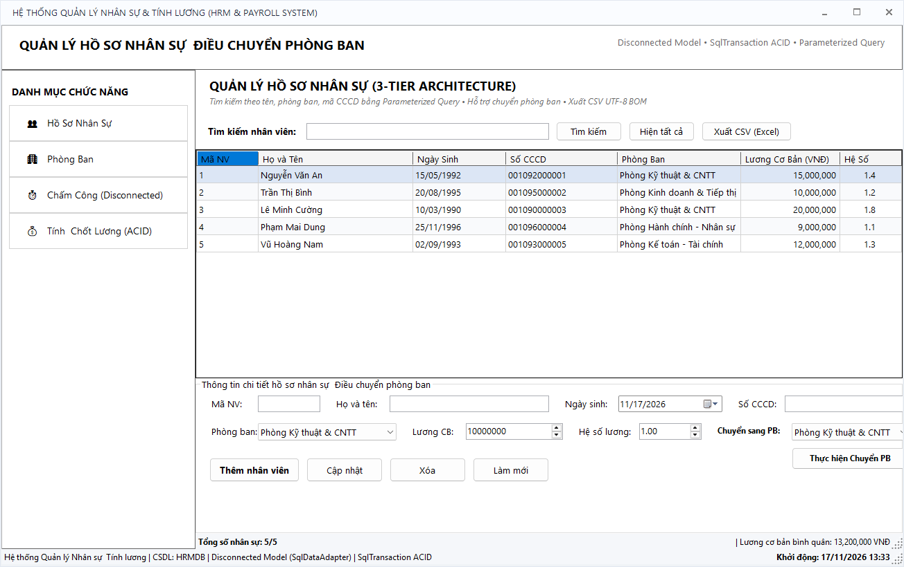
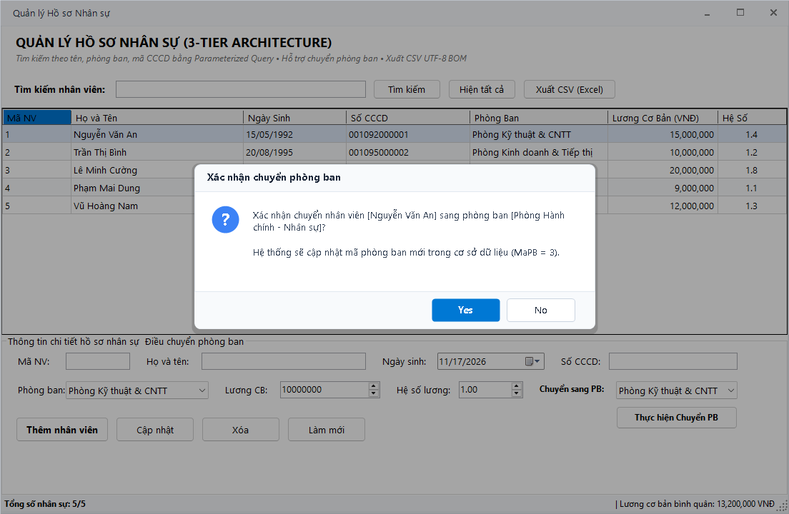
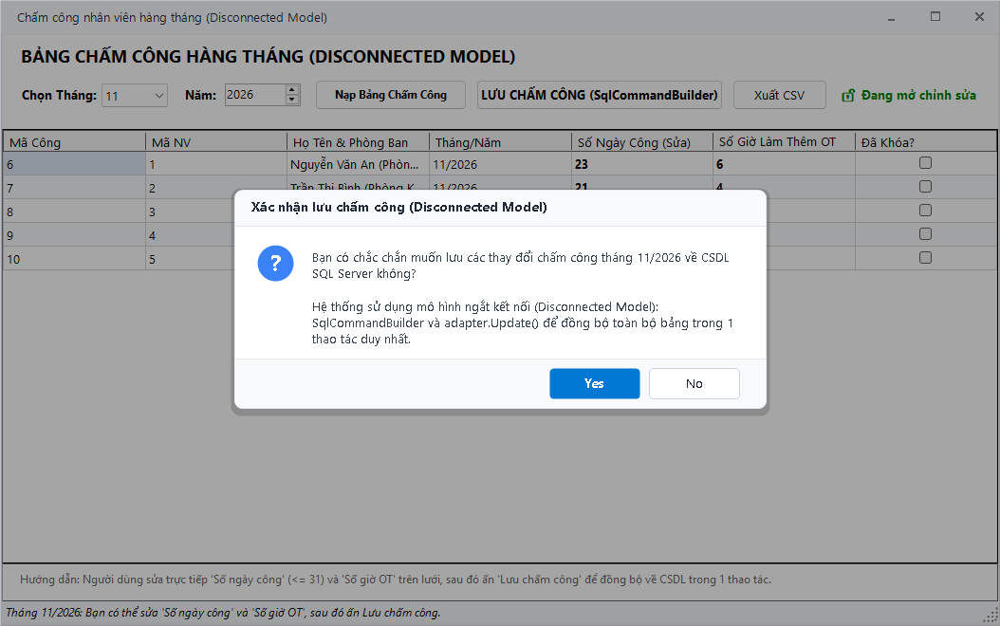
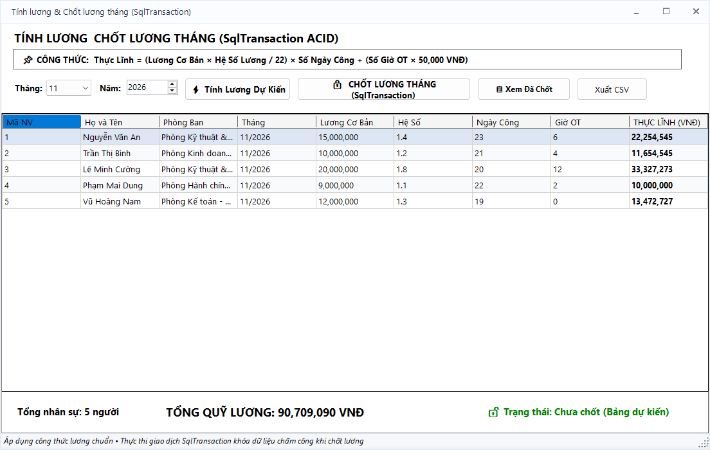
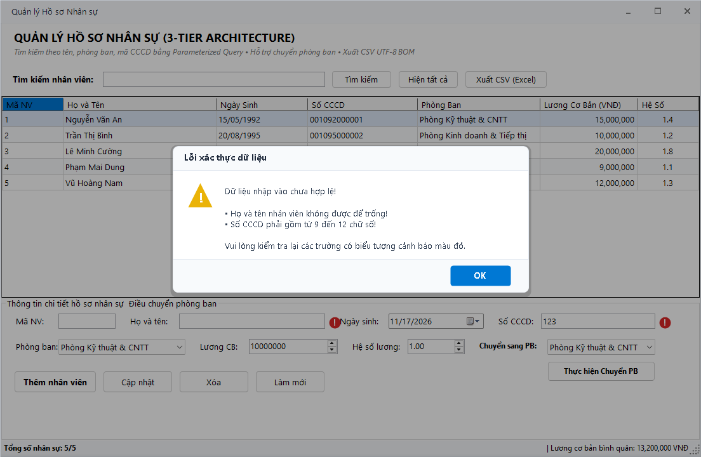

# BÁO CÁO ÔN TẬP THỰC HÀNH WINDOWS FORMS

## THÔNG TIN SINH VIÊN
- **Họ và tên:** Nguyễn Thành Nam
- **Mã số sinh viên:** 24810310230
- **Lớp:** D19CNPM3
- **Tên môn học:** Lập trình C# / Windows Forms (.NET 10)

---

## BÀI TẬP: BÀI 6.2 - HỆ THỐNG QUẢN LÝ NHÂN SỰ & TÍNH LƯƠNG (HRM & PAYROLL SYSTEM)

### 1. MỤC TIÊU & KIẾN TRÚC HỆ THỐNG
- **Kiến trúc 3-Tier chuẩn mực:**
  - `DTO (Data Transfer Object)`: `PhongBanDTO`, `NhanVienDTO`, `BangChamCongDTO`, `BangLuongDTO`. Tất cả kế thừa `BindableBase` triển khai `INotifyPropertyChanged`.
  - `DAL (Data Access Layer)`: Truy vấn dữ liệu ADO.NET bằng `Microsoft.Data.SqlClient`, sử dụng `SqlParameter` 100% phòng chống SQL Injection.
  - `BUS (Business Logic Layer)`: Nghiệp vụ điều chuyển phòng ban, tính công, tính lương và chốt lương.
  - `GUI (Presentation Layer)`: Giao diện WinForms hiện đại, responsive, có ErrorProvider và StatusStrip tính toán tự động.
- **Mô hình ngắt kết nối (Disconnected Model):**
  - Sử dụng `SqlDataAdapter`, `DataSet`, `DataTable` để nạp toàn bộ nhân viên vào bảng chấm công hàng tháng trên `DataGridView`.
  - Người dùng chỉnh sửa trực tiếp số ngày công (<= 31) và số giờ làm thêm (OT >= 0) trên lưới.
  - Khi ấn "Lưu chấm công", sử dụng `SqlCommandBuilder` và `adapter.Update()` để đồng bộ toàn bộ bảng dữ liệu về SQL Server trong **1 thao tác duy nhất**.
- **Tính Lương & Chốt Lương (`SqlTransaction`):**
  - Công thức tính lương nâng cao:
    $$\text{Thực Lĩnh} = \left(\frac{\text{Lương Cơ Bản} \times \text{Hệ Số Lương}}{22}\right) \times \text{Số Ngày Công} + (\text{Số Giờ OT} \times 50{,}000)$$
  - Khi ấn "Chốt lương tháng", mở một `SqlTransaction` để ghi nhận bảng lương chi tiết cho toàn bộ nhân viên và khóa dữ liệu chấm công (`DaKhoa = 1`) để ngăn sửa đổi sau khi chốt.
- **Tính năng nâng cao:** Xuất danh sách nhân sự, bảng chấm công, bảng lương ra file CSV chuẩn UTF-8 BOM hiển thị tiếng Việt hoàn hảo trên Excel.

---

### 2. CƠ SỞ DỮ LIỆU (HRMDB)
Cơ sở dữ liệu bao gồm 4 bảng chính:
1. `PhongBan (MaPB INT IDENTITY PK, TenPB NVARCHAR(100), Mota NVARCHAR(255))`
2. `NhanVien (MaNV INT IDENTITY PK, HoTen NVARCHAR(100), NgaySinh DATETIME, CCCD VARCHAR(20) UNIQUE, MaPB INT FK, LuongCoBan DECIMAL(18,2) CHECK > 0, HeSoLuong FLOAT DEFAULT 1.0)`
3. `BangChamCong (MaCong INT IDENTITY PK, MaNV INT FK, ThangNam VARCHAR(7), SoNgayCong FLOAT CHECK <= 31, SoGioOT FLOAT DEFAULT 0, DaKhoa BIT DEFAULT 0, UNIQUE(MaNV, ThangNam))`
4. `BangLuong (MaLuong INT IDENTITY UNIQUE, MaNV INT FK, ThangNam VARCHAR(7), ThucLinh DECIMAL(18,2) CHECK >= 0, PK(MaNV, ThangNam))`

File script khởi tạo CSDL nằm tại [Database/ScriptDB.sql](Database/ScriptDB.sql).

---

### 3. KẾT QUẢ THỰC HÀNH & HÌNH ẢNH MINH HỌA

#### 3.1. Giao diện chính / Quản lý Hồ sơ Nhân sự
Giao diện quản lý hồ sơ nhân viên hiển thị thông tin chi tiết: Họ tên, Ngày sinh, CCCD, Phòng ban, Lương cơ bản và Hệ số lương. Thanh tìm kiếm hỗ trợ lọc nhanh theo tên, phòng ban hoặc mã CCCD bằng Parameterized Query.

#### 3.2. Quản lý Danh mục & Điều chuyển Phòng ban
Cho phép thêm, sửa, xóa thông tin nhân viên có hộp thoại xác nhận. Tích hợp tính năng chuyển nhân viên sang phòng ban mới với hộp thoại xác nhận và cập nhật trực tiếp vào CSDL.

#### 3.3. Chấm công ngắt kết nối (Disconnected Model: DataSet / SqlDataAdapter)
Lựa chọn Tháng/Năm, hệ thống sử dụng `SqlDataAdapter` nạp danh sách nhân viên vào `DataTable` ngắt kết nối. Cho phép chỉnh sửa số ngày công và giờ OT trực tiếp trên lưới; ấn nút "Lưu chấm công" để `SqlCommandBuilder` tự động sinh câu lệnh và `adapter.Update()` đồng bộ dữ liệu về SQL Server trong 1 thao tác.

#### 3.4. Báo cáo Tính & Chốt Lương Tháng (SqlTransaction ACID)
Hệ thống tự động tính lương dự kiến theo công thức:
$$\text{Thực Lĩnh} = \left(\frac{\text{Lương Cơ Bản} \times \text{Hệ Số Lương}}{22}\right) \times \text{Số Ngày Công} + (\text{Số Giờ OT} \times 50{,}000)$$
Khi ấn "Chốt lương tháng", mở một `SqlTransaction` để ghi nhận bảng lương chi tiết cho toàn bộ nhân sự và khóa dữ liệu chấm công.

#### 3.5. Minh họa An toàn Dữ liệu & ErrorProvider Validation
Hệ thống kiểm tra toàn diện tính hợp lệ của dữ liệu đầu vào: bắt buộc nhập Họ tên, số CCCD phải gồm từ 9-12 chữ số, lương cơ bản và hệ số lương phải lớn hơn 0. Khi có lỗi, `ErrorProvider` hiển thị biểu tượng chấm than đỏ và hộp thoại cảnh báo ngăn chặn lưu dữ liệu sai.

